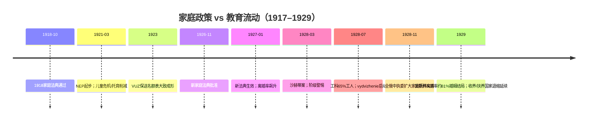

# 精读札记（W10）：性别—家庭政策与提拔生通道（1917–1929）

- **对读文献**：
  - Wendy Z. Goldman, *Women, the State and Revolution: Soviet Family Policy and Social Life, 1917–1936*（中译本：`sources/monographs/goldman_1993_women_state_rev_zh/`）
  - Sheila Fitzpatrick, *Education and Social Mobility in the Soviet Union, 1921–1934*（`sources/monographs/fitzpatrick_1979_education_mobility/`）
- **顺读范围**：
  - Goldman：ch.1（1918 法典）、ch.2–3（NEP 与流浪儿童/女性失业）、ch.4–6（农民家户 vs 1926 法典辩论）、ch.8 前半（至 1929 年家庭责任回摆）
  - Fitzpatrick：Part I ch.3–5（阶级配额、资产阶级中等教育、教授与 NEP 妥协）、Part II ch.6（1928 沙赫蒂案与 vydvizhenie）
- **关联论断卡**：
  - [`CLM-goldman-1993-1918-family-code-and-nep-reality`](../../historiography/claims/CLM-goldman-1993-1918-family-code-and-nep-reality.md)
  - [`CLM-goldman-1993-1926-marriage-code-peasant-worker-clash`](../../historiography/claims/CLM-goldman-1993-1926-marriage-code-peasant-worker-clash.md)
  - [`CLM-fitzpatrick-1979-nep-education-and-bourgeois-specialists`](../../historiography/claims/CLM-fitzpatrick-1979-nep-education-and-bourgeois-specialists.md)
  - [`CLM-fitzpatrick-1979-1928-shakhty-and-vydvizhentsy`](../../historiography/claims/CLM-fitzpatrick-1979-1928-shakhty-and-vydvizhentsy.md)

---

## 一、问题意识：两条“社会再生产”通道如何在大转变前夜分岔

Goldman 与 Fitzpatrick 从不同截面追问同一结构矛盾：**革命话语承诺的阶级—性别解放**，与 **NEP 财政治约下国家无力承担社会化再生产成本** 之间的张力。前者聚焦于家庭法、儿童福利与性别劳动分工；后者聚焦于教育系统作为向上流动与“无产阶级干部”生产的机器。至 1928–1929，沙赫蒂案与工业化冲锋把两条线索同时推向 **保守化家庭责任** 与 **工人提拔（vydvizhenie）**——并非偶然并列，而是同一政权在积累压力下对“廉价再生产”与“可靠技术忠诚”的双重索取。

---

## 二、Goldman：1918 法典愿景、家庭消亡论与 NEP 现实（至 1929）

### 1. 1918《家庭法典》：马克思主义“过渡立法”与家庭消亡预期

- 法典在民事婚姻、单方离婚、非婚生子女平等、限制婚姻内财产牵连等方面超前于当时欧洲立法，但起草者（戈伊赫巴尔格、库尔斯基等）明确将其定位为 **“过渡时期立法”**：登记、扶养等条款只因国家尚无全面福利才暂时保留；法律与家庭、国家一道预期 **终将消亡**（`ch04`，PDF pp. 59–65）。
- 全俄中央执行委员会辩论中，罗斯拉韦茨从自由主义左翼抨击 **国家登记婚姻** 为“资产阶级残余”，主张只登记出生；戈伊赫巴尔格则以 **打垮教会婚姻** 为由捍卫登记——显示 1918 年家族政策已是 **革命形式主义 vs 彻底废除婚姻** 的折衷。

### 2. 内战—饥荒：“家庭消亡”被灾难性预演

- 1921–1922 饥荒使家庭 **非渐进瓦解而是暴力粉碎**；流浪儿童（besprizornye）规模与国家的收容能力严重失衡（1921 年儿童之家约 54 万儿、`ch05` p. 79）。
- 1919 年教育家乌托邦（国家充当“大家庭”、社会化抚养解放妇女）遭遇代表伊琳娜的 **现实主义反驳**：儿童之家是“寄生性”消费单位，在不能生产自给前不能取代家庭（`ch05` pp. 73–74）。

### 3. NEP：公共服务萎缩 → 女性失业 → 流浪儿童回潮

- NEP 成本核算导致 **托儿所网络“几乎化为乌有”**、儿童机构锐减；单身母亲无日托即无法就业，儿童再流落街头，形成 **母亲—儿童—国家资源** 的恶性循环（`ch05` pp. 85–88）。
- 1921 年女性占工会会员约 45%，但 NEP 裁员中 **失业者 60%+ 为女性**；1921–1927 登记失业女性从约 6.1 万增至约 37 万（六倍，`ch06` pp. 125–126）。
- 高离婚率（1926 莫斯科约每两桩婚姻一例离婚）与 **扶养费执行难** 表明：1918 年“婚姻自由”在阶级—性别环境中 **主要利好能自保者**，有孩女工仍陷生存斗争（`ch06` pp. 123–124, 125）。

### 4. 1926 法典辩论：城乡、工人先锋 vs 农民家户

- 1925–1926 年六千余场基层辩论；**约 60% 主要发言人基于道德理由反对草案，其中 35% 自命农民代言人**（`ch09` p. 243）。
- **加里宁/基谢廖夫（亲布哈林 NEP 路线）**：频繁离婚与家户财产规则威胁农业再生产；沙赫纳扎罗夫诉诸 **工农联盟（смычка）**，反对拿中农做“实验”。
- **克雷连科/普列奥布拉任斯基（偏工业化左翼）**：家庭法应服从 **工人阶级“领导阶级”** 需求，“必须果断终结维护农民家庭这种反动空想”；不能因中农不适应而 **立法倒退**（`ch09` pp. 247–248）。
- Goldman 指出：法典辩论 **并非** 1925–1926 党中央派争的镜像，但 **农业路线争论渗入家庭法**——与 Fitzpatrick 笔下 NEP 末期“阶级警惕”升级遥相呼应。

### 5. 1927–1929：法典后果与“家庭复兴”政策萌芽（Goldman 所称第一次保守转向）

- 1926 法典生效后离婚率跳升（1929 莫斯科 PDF 表：离婚率约 10.1/千人，`ch11` p. 337）；国家无力承担扶养，转而 **1928–1929 扩大“家庭”法律义务**（继父母抚养、追缉拖欠扶养费、推广市民收养以减轻儿童之家），沃尔夫松 1929 年仍言国家与经济 **“被迫利用家庭这一社会细胞”**（`ch11` pp. 349–350）。
- 1928 年起动集体化/工业化后，儿童街头化、无人监管问题恶化，但此阶段仍是 **行政实用主义** 修补，尚非 1936 年意识形态大逆转；**1929 年** 已可见政策重心从“家庭消亡”话语向 **强化亲职责任与国家甩锅** 滑动——为斯大林时代“社会主义家庭”奠基。

---

## 三、Fitzpatrick：NEP 教育种族隔离、资产阶级专家与 1928 提拔生运动

### 1. 高等教育招生的“阶级原则”与漏洞（1921–1927）

- 1921 年起 **komandirovanie（组织保送）** 制度化；1923 年 Narkompros 分配 VUZ 名额：党组织 20%、工会 45%、共青团 15% 等，但各地执行 **混乱且常形式化**（`ch03`，PDF pp. 100–101）。
- 列宁格勒大学社科学院仍有约 **三分之一** 入学者为旧“ intelligentsia / meshchane / 贵族 / 旧军官子弟”等（1922 年，`ch03` p. 100）。
- 1926–1927 年收紧入学考试、**放松社会政治标准** 后，普通中学毕业生 **46.4%** 占 1927 年高校新生——呈现 NEP 晚期 **学术标准回摆** 与共青团“无产阶级学校”诉求的冲突（`ch02` pp. 66–67, 311–312）。

### 2. “资产阶级”中等学校与就业死胡同

- 共青团推动把 **普通中学profuklon（职员倾向）** 当作 “雇员子弟学校”；1926 年莫斯科 3500 名毕业生中仅 400 人找到工作（`ch02` p. 66），强化 **教育通胀与阶级怨气**。
- 农民自述：“大学从前对穷人关闭，现在也一样”；竞争性考试利于能请家教者（`ch02` pp. 68–69）——与农村青年经 ShKM/rabfak “上升通道”的有限机会形成对照。

### 3. 教授—苏维埃权力：政策和解 vs 车间敌意

- 内战教授普遍敌对，但 NEP 官方 **任用并安抚“资产阶级专家”**；VUZ 内形成 **共产党学生 vs 老教授** 势力分区，Narkompros 居间调解（`ch02` ch.4，PDF pp. 74–77）。
- 工厂层面 **spetseedstvo（整专家）**  endemic；最高层合作与基层敌意并存——沙赫蒂案前已积累 **阶级警惕** 情感库（`ch04` pp. 123–125）。

### 4. 1928 沙赫蒂案 → 文化战线夺权 → vydvizhenie

- 案件被处理为 **阶级代表受审**；Krinitsky 驳斥“和平文化革命”观，要求 **无产阶级文化霸权**（`ch04` pp. 125–126）。
- 斯大林在 1928 年 4 月全会把结论引向：**工人阶级须造就自己的技术知识分子**，“非无产阶级出身的指挥与技术干部”不可信（`ch04` pp. 128–129）。
- 1928 年 7 月中央全会：**工科招生 65% 工人**、增开预备班、额外增招 3000 工人进 rabfak 等——Fitzpatrick 称 **“great vydvizhenie”** 由此发动（`ch04` p. 139）。
- 布哈林—李可夫右派在 VTUZ 归属上与 Narkompros 结盟反 Vesenkha，但 **无力阻止选拔标准政治化**；卢那察尔斯基反沙赫蒂后“普遍怀疑”路线，反遭青年派攻其庇护专家（`ch04` pp. 131–132）。

---

## 四、对读综合：性别—家庭“国家撤退”与技术干部“国家进攻”

| 维度 | Goldman（家庭/性别） | Fitzpatrick（教育/流动） | 1928–1929 接合点 |
| :--- | :--- | :--- | :--- |
| 国家能力 | 无力养育流浪儿、日托、扶养执行 → **家庭回担再生产** | 无力统一贯彻“教育机会均等” → **多元/漏洞选拔** | 积累战取代 NEP 社会支出与技术妥协 |
| 阶级政治 | 1926 法典：工人立法 vs 农民家户；扶养案阶级不对称 | NEP：专家合作 + 工厂反专家；共产党生多出自职员家庭 | 沙赫蒂将“专家”整体转为 **潜在破坏者阶级** |
| 女性位置 | 失业、单亲、无日托 → **法律自由≠社会自主** | （本书较少写性别；可互补）女性 1929 仍在进入劳动力“蜗牛速度”（Goldman `ch11` p. 352） | 工业化动员后期才大规模吸纳女工；此前家庭仍为主要安全网 |
| 史学分歧 | 1926 法典：进步 vs 保守（Berman/Quigley 争论，Goldman 综述 `ch09` p. 245） | 文化革命：自上而下动员 vs Narkompros 标准维护 | 二者均反对把斯大林转向简化为“必然” |

**经验共识（两书可对接）**：NEP 国家 **口头革命主义** 与 **财政—行政稀缺** 之间的裂缝，在 1927–1929 未得弥合便被 **非常工业化** 放大。

**解释张力**：

- Goldman 强调 **性别与家户物质再生产** 如何制约激进家庭法；
- Fitzpatrick 强调 **教育政治** 如何生产“可疑”的知识精英与补救性的工人干部。
- 托派/左翼马克思主义读者可能追问：普列奥布拉任斯基在 1926 法典辩论中的 **亲法典、反农民家户** 立场，与 Fitzpatrick 笔下共青团 **反“资产阶级中学”** 是否同一“文化革命”谱系先声；右派 NEP 辩护（加里宁、Rykov、卢那察尔斯基）是否在 **专家—家庭** 两条战线同时失守。

---

## 五、知识库挂接与盲区

- **宜关联卡片**：`POL-nep`、`POL-ban-on-factions-1921`（间接）、1926/1928 家庭法政策节点（待 `POL-*`）、`ORG-workers-opposition`（什利亚普尼科夫与 NEP 批评，`ch05`）、`PER-stalin`/`PER-bukharin`/`PER-preobrazhensky`、概念 `CON-socialism-in-one-country`（教育文化保卫）。
- **盲区告警**：Goldman 中译本未保留英文逐句原文，论断卡引文以中译本 PDF 页为准；Fitzpatrick 对 **女性教育/性别配额** 着墨有限，性别维度本轮以 Goldman 为主轴。
- **待补档案**：1926 法典基层速记全文、1928 年 7 月全会教育决议与 VTUZ 招生原始统计、besprizornye 性别分布（Goldman 指出委员会档案男孩占比畸高原因未明）。

---

## 六、时间线（1917–1929，双轨并列）

