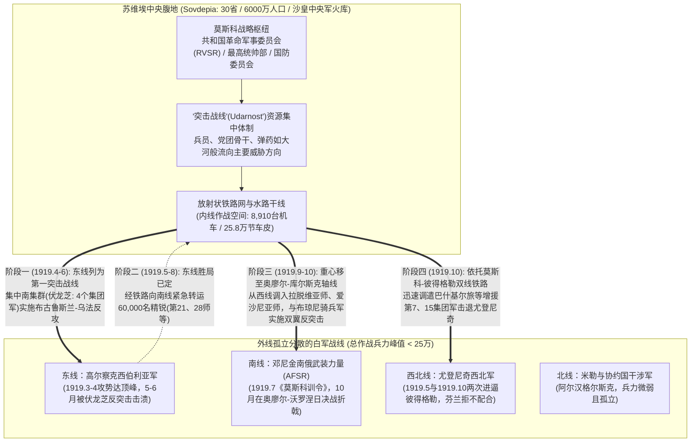

# 俄国内战的地缘人口基本盘、军事专家体制与内线铁路机动战略：莫兹利与卡库林深度对读札记

## 一、 问题意识与对读视角：西方结构主义综合史与红军总参战略复盘的交汇

俄国内战（1917—1920/1922）的胜负究竟取决于何种核心机制？在苏联早期官方叙事与斯大林时代的党史神话中，红军的胜利往往被归结为布尔什维克党的意识形态感召力、无产阶级先锋队的牺牲精神或统帅个人的“天才预见”；而在流亡白军将领（如邓尼金、弗兰格尔）的回忆录中，失败则常被归咎于协约国援助的摇摆、指挥官之间的个人倾轧或偶发的战术失误。

将英国格拉斯哥大学历史学家埃文·莫兹利（Evan Mawdsley）出版于1987年的西方修正派军事-社会综合史经典《俄国内战》（*The Russian Civil War*），与前沙皇陆军上校、红军总参谋部军事学院高级战略教官尼古拉·叶夫根尼耶维奇·卡库林（N. E. Kakurin, 1883—1936）写于1928年的两卷本军事学术巨著《革命是如何战斗的》（英译本 *The Russian Civil War, 1918–1921*）进行深度对读，能够穿透意识形态迷雾，在**地缘人口与军工遗产的结构性不对称**、**旧军官团（军事专家）与政委监控的组织复合体**、**内线铁路机动与“突击战线”（Udarnost'）的资源调配机制**，以及**白军在土地问题、大俄罗斯民族主义与外线冒险战略上的系统性破产**四个维度上，构建出解释内战结局的坚实分析框架。

尤为重要的是，莫兹利在书中多次直接征引卡库林等苏联1920年代末军事史家（在斯大林个人崇拜全面窒息军事史学之前撰写的）高度诚实的统计与战役分析（如关于1919年下半年以前红军完全依赖沙皇旧军火库遗产的判断）；而卡库林则从总参谋部作战处与前线集团军参谋长的内部视角，为莫兹利的宏观结构论断提供了精确到师团番号、铁路车皮损耗率、每公里步兵密度与统帅部电报往来的作战级微观实证。

---

## 二、 “苏维埃腹地”（Sovdepia）的地缘人口基本盘与沙皇军工遗产

### 1. 破除“布尔什维克仅控狭小孤岛”的迷思：人口与族裔压倒性优势
莫兹利在第一部分总结章（第5章〈苏托邦的建立〉）与全书终章（第20章〈结论〉）中首先破除了长期流行的视觉错觉：地图上四面受敌的苏维埃政权绝非困守一隅的弱小派系。

* **领土与人口基本盘**：尽管布尔什维克在1918年失去了波罗的海诸省、白俄罗斯、芬兰、乌克兰、顿河、库班、外高加索、西伯利亚、乌拉尔、北极海滨和伏尔加河中游，但苏维埃一直牢固掌握的中央30个省——即白军蔑称的“苏托邦”（Sovdepia，苏维埃腹地）——面积超过**250万平方公里**（大于当时欧洲所有交战国面积的总和），常住人口高达**约6000万**，超过欧亚大陆上任何其他竞争政权（Mawdsley, `ch06_第一部分_1918_决断之年_part_3.md#L773-L780`, p. 69）。
* **对白军根据地的人口碾压**：相比之下，高尔察克与邓尼金在1918—1919年冬季各自控制的根据地人口均不足苏维埃腹地的一半；尤其是邓尼金的“南俄罗斯武装力量”（AFSR），其北高加索与顿河核心基地的总人口仅**800万至900万**（仅为苏维埃腹地的六分之一），且其中作为白军绝对主力的哥萨克人口仅有**300万**（Mawdsley, `ch13_第二部分_1919_白军之年_part_5.md#L343-L348`, p. 217）。
* **大俄罗斯族裔核心区的同质性**：苏维埃腹地几乎全部由大俄罗斯族构成，大俄罗斯族对除乌克兰人以外的任何少数民族都拥有**15比1以上**的人口绝对优势（Mawdsley, `ch16_第三部分_1920_胜利之年_part_3.md#L478-L482`, p. 288）。这使布尔什维克在征兵动员和行政整合上免受边疆多民族分裂的困扰。

### 2. 沙皇军火库存的垄断：“靠旧军队的遗产过活”
内战是一场在工业全面萎缩背景下进行的战争。莫兹利与卡库林一致指出，谁控制了1914—1917年帝国总动员留下的中央军火库与兵工厂，谁就握有了建立百万常备军的物质前提。

| 军工与库存指标 | 一战沙俄采购/1916年产量 | 1919年初苏维埃库存 / 1919年实际产量 | 1919年产量占1916年峰值比例 | 史源锚点 |
| :--- | :--- | :--- | :--- | :--- |
| **步枪** | 一战共采购1100万支；1916年产132.1万支 | 1919年初中央库存约**60万支**；1919年产**46万支** | **35%** | Mawdsley, `ch12#L162-L185`, pp. 187–188 |
| **机枪** | 一战共采购7.6万挺；1916年产11,072挺 | 1919年初中央库存约**8,000挺**；1919年产**6,256挺** | **57%** | Mawdsley, `ch12#L162-L185`, pp. 187–188 |
| **野战火炮** | 一战共采购1.7万门；1916年产8,208门 | 1919年初中央库存约**1,700门**；1919年仅产**152门** | **2%** | Mawdsley, `ch12#L162-L185`, pp. 187–188 |
| **枪弹（子弹）** | 1916年产14.82亿发 | 1919年产**3.4006亿发**（图拉占50%以上） | **23%** | Mawdsley, `ch12#L172-L195`, pp. 187–188 |
| **炮弹** | 1916年产3300万发 | 1919年仅产**184,998发** | **< 1%** | Mawdsley, `ch12#L172-L185`, pp. 187–188 |

* **核心结论**：由于失去了乌克兰与乌拉尔的煤铁基地，苏维埃1919年的重武器（火炮、炮弹）新造能力几乎归零（仅为1916年的1%—2%）。莫兹利特别引证1928年苏联官方内战史（即卡库林等人参与编纂的战史）的坦率承认：**“直到那时（1919年下半年）我们都一直在用旧军队的遗产。”**（Mawdsley, `ch12_第二部分_1919_白军之年_part_4.md#L186-L190`, p. 188）。正是因为一战留存的5%—10%完好武器绝大多数储存在俄罗斯中央地带的沙皇军火库中，且图拉（Tula）、伊热夫斯克（Izhevsk）、辛比尔斯克等核心轻武器与子弹工厂位于或被夺回苏维埃腹地，红军才得以在没有外援的情况下武装起300万大军，而白军则不得不依赖漫长海运线上的英法剩余物资援助。

---

## 三、 军事专家（Voenspetsy）、旧军士与政治委员的制度复合体

布尔什维克如何将6000万人口的潜力转化为战场上击败职业白军的有组织力量？莫兹利通过对红军建军制度的细致解剖表明，决定性的转折在于1918年春抛弃“志愿赤卫队/游击主义”（Partizanshchina），建立起以**前沙皇军官（军事专家）为指挥中枢、前沙皇军士（NCOs）与红色指挥员为基层骨干、政治委员与党员为“铁腰撑”（iron corset）、农民征召兵为主体**的常规化大规模陆军。

### 1. 邦奇-布鲁耶维奇、托洛茨基与旧帝国军事行政骨架的整体移植
* **从“将军陷阱”到全俄总参谋部**：1918年2月德军“拳击行动”粉碎了旧陆军残余与赤卫队神话后，前沙皇北方面军参谋长米哈伊尔·邦奇-布鲁耶维奇将军（M. D. Bonch-Bruevich）率旧最高统帅部人员乘坐专列（被戏称为“将军陷阱”，General Trap）投奔布尔什维克，主持最高军事委员会（VVS）（Mawdsley, `ch06_第一部分_1918_决断之年_part_3.md#L33-L45`, p. 51）。
* **组织连续性**：1918年3月托洛茨基出任最高军事委员会主席与陆海军人民委员后，于5月建立**全俄总参谋部**（Vseroglavshtab），直接接管了原沙皇陆军部和总参谋部的档案、动员规程与军事学堂体系，并在全国设立6个（后扩为7个）军区及省、县、乡三级军事委员会（Voenkomaty），从而使系统性的强制征兵成为可能（Mawdsley, `ch06#L208-L216`, p. 56; `ch12#L63-L73`, p. 185）。

### 2. 军事专家（Voenspetsy）与前沙皇军士的规模与历史作用
莫兹利提供了极具说服力的量化数据，证明红军指挥层对旧帝国军人阶层的深度依赖：
* **军事专家（Voenspetsy）**：1918年7月第五次全俄苏维埃代表大会正式批准强制征召前沙皇军官。建军最初几个月已有约**8,000名**前军官志愿加入；至1918年底增至**22,000名**；整个内战期间共有**超过48,000名**前沙皇军官在红军服役（加上文职与后勤人员规模更大），占红军指挥员总数的极大比重（在步兵师长、集团军司令、方面军司令及总参谋部层级几乎垄断，如两任总司令瓦采季斯与加米涅夫、大本营参谋长列别杰夫等）（Mawdsley, `ch06#L229-L246`, pp. 56–57; `ch12#L100-L120`, p. 186）。
* **被忽视的基层脊梁——前沙皇军士（Unter-ofitsery）与红色指挥员（Komandiry）**：除了高级参谋与指挥官，红军还征召了约**215,000名**前沙皇陆军军士（士官）担任排、连级基层指挥与训练骨干；同时通过速成训练班（Kursanty）在1918年培养了2,000名、1919年11,000名、1920年25,000名工农出身的“红色指挥员”（Mawdsley, `ch12#L121-L133`, p. 186）。
* **政治委员（Voenkomy）与党员“铁腰撑”**：为防范旧军官叛变（如1918年7月穆拉维约夫叛乱）并督促厌战农民士兵作战，布尔什维克推行双重签署制（命令须经指挥官与政委共同签署方才有效，且政委不干预纯作战技术但掌握生杀监督权），并以托洛茨基对怯懦撤退部队采取的严酷军法（包括什一抽杀律）及家属人质制维持纪律。到1919年秋，红军中共有约**12万名正式党员和4万名预备党员**（占军队总数的5%—10%），构成了支撑庞大农民征召军的“铁腰撑”（Mawdsley, `ch06#L247-L258`, p. 57; `ch12#L134-L154`, pp. 186–187）。

### 3. 红军规模扩张与“逃兵—回收”的官僚动员韧性
* **兵力跃升与低作战齿比**：红军总兵力从1918年底的约**70万人**，跃升至1919年6月的**150万人**，再到1919年底至1920年的**300万人**以上（Mawdsley, `ch12#L51-L62`, p. 185）。尽管由于后勤和行政效率低下，红军的作战部队与总兵力之比不足1:4（如1919年6月150万在册兵力中，后方军区有53.8万人，前线方面军89.9万人，而实际一线作战兵力即“刺刀与马刀”仅**35.6万人**），但这一作战兵力依然对白军形成了压倒性数量优势（Mawdsley, `ch12#L55-L62`, p. 185）。
* **制度化应对农民逃兵**：1919年红军登记在册的逃兵（含未按期报到者）高达**170万人**，但苏维埃通过“反逃兵中央委员会”（Tsentrokomdezertir）与农村苏维埃网络，结合“自首免罚”政策，在1919年下半年成功回收了上百万逃兵（Mawdsley, `ch12#L74-L99`, pp. 185–186）。这种建立在中央腹地行政网络上的动员韧性，是白军在占领区靠抓壮丁和战俘改编完全无法比拟的。

---

## 四、 内线铁路机动、“突击战线”机制与1919决战年：卡库林与莫兹利的战略对读

如果说莫兹利从宏观上指出了“莫斯科交通枢纽使四面受敌的红军可以一个接一个地击败各自孤立的敌人”（借用丘吉尔“莫斯科像蛛网中心的蜘蛛”之喻，Mawdsley, `ch16#L283-L287`, pp. 283–284），那么卡库林在《1918—1920年俄国内战》中则以总参谋部作战学家的专业眼光，深入剖析了**内线作战（Interior Operational Lines）的运筹逻辑、铁路运输瓶颈的物理约束，以及1919年东线与南线决战的战役转换机制**。

### 1. 卡库林论内线战略的双刃剑：铁路运力衰竭与“梯次累积突击”
卡库林在全书〈前言〉（Foreword）与第5章中提出了一个极为深刻的军事理论洞见：红军固然享有内线作战的几何优势，但**切不可用西欧密集铁路网的标准来想象俄国内战的内线机动**。
* **铁路运力的灾难性损耗**：卡库林列举了精确的交通统计数据——1916年俄国正常运转的铁路机车有**20,290台**，到1918年底苏维埃控制区仅剩**8,910台**，且其中**4,231台（近50%）处于损坏待修状态**；货运车皮从1916年的**56.3万节**锐减至1918年底的**25.8万节**，其中损坏率同样达16.6%（4.3万节）（Kakurin, `ch09_5_the_german_occupation_and_revolution_t.md#L730-L758`, p. 91）。
* **空间距离与时间延宕**：由于战区极其辽阔且机车、燃料（顿巴斯煤炭与巴库石油断绝，改烧木柴）极度匮乏，红军在各战线之间的战略兵力调动在时间上被极度拉长。因此，卡库林总结道：
  > “红军战略处于内线作战一方的态势，正确地寻求利用这一态势，根据全局形势将紧迫的重要性赋予这一或那一方面军。但客观原因——即铁路运输状况的不佳与战区的辽阔——在时间上极度拉长了我军所有的战役调动，这是各战线战役旷日持久的主要原因之一。由于这一情况，我方战略的行动表现为**在选定的主攻轴线上，由一系列梯次累积的努力（a series of successively accumulating efforts）有条不紊地发展为最终胜利**。”（Kakurin, `ch04_foreword.md#L63-L76`, p. xvii）。

### 2. “突击战线”（Shock Front / Udarnost'）的资源调配机制
为了在资源枯竭和铁路瓶颈下实现内线歼敌，苏维埃建立了一套高度集权的战时供给与调配机制。卡库林将其概括为**“突击工作法”（shock method）与“突击战线”（shock front）**：
* 当某条战线成为威胁苏维埃生死存亡的首要方向时，党、国家与经济机关（最高国民经济委员会 VSNKh、交通人民委员部、工农国防委员会）的全部注意力便集中于此，“增援部队与各类补给便会像一条宽阔的大河一样流向该战线，代价则是暂时削弱其他各条战线”（Kakurin, `ch09#L778-L793`, p. 92）。
* 在内战三年间，“突击战线”的头衔在东线、南线与西线之间多次轮转。莫兹利与卡库林的数据共同印证了这一机制在1919年决战中的运作：
  1. **1919年春东线危机与伏龙芝反突击**：1919年3—4月高尔察克西伯利亚军突破红军东线中路（乌法方向）逼近伏尔加河。苏维埃将东线列为首要突击战线，大举调入共产党员、工会动员兵与后备军。东线南集群司令伏龙芝（M. V. Frunze）集中第1、第4、突厥斯坦与第5集团军，在布古鲁斯兰—别列别伊—乌法战役（1919年4月底至6月）中从南翼猛击高尔察克过度延伸的汉任（Khanzhin）西集团军侧翼，一举扭转东线战局（Kakurin, `ch12_8_operations_in_the_east_in_the_spring_a.md#L636-L700`, pp. 143–145; Mawdsley, `ch10_第二部分_1919_白军之年_part_2.md`, pp. 145–152）。
  2. **1919年5—8月从东线向南线的大规模铁路调兵**：高尔察克败局甫定，红军总司令加米涅夫（S. S. Kamenev）与共和国革命军事委员会立即利用内线铁路，在1919年5月至8月间从东线（主要是攻克乌拉尔的第2集团军等部）向南线秘密转运了**60,000名老练官兵**（包括第21、第28步兵师等精锐），使南线红军得以重建战略预备队（Kakurin, `ch14_10_the_spring_and_summer_campaign_of_191.md#L1017-L1025`, `#L1060-L1062`, `#L1106-L1107`, pp. 200–202）。
  3. **1919年9—10月从西线向南线（奥廖尔轴线）及彼得格勒的极限抽调**：当邓尼金的第1军（库捷波夫部）于9月20日攻占库尔斯克、10月13日攻占奥廖尔，直接威胁图拉兵工厂与莫斯科时，红军统帅部与9月21日和26日俄共（布）中央全会果断将战略重心移至奥廖尔—库尔斯克中路，并于9月30日将南线一分为二（由叶戈罗夫任司令、斯大林任革委会委员的南方面军专司中路决战，肖林指挥的东南方面军牵制顿河方向）。统帅部通过铁路从西线紧急抽调最精锐的**拉脱维亚步兵师、巴甫洛夫独立步兵旅、爱沙尼亚步兵师**，从东南调回**布琼尼骑兵军**，同时将乌拉尔调来的巴什基尔旅等部投入彼得格勒方向挫败尤登尼奇的十月攻势（Kakurin, `ch09#L801-L810`, p. 93; `ch15_11_the_oryol_operation.md#L278-L308`, `#L504-L509`, pp. 215, 220）。

### 3. 卡库林对1919年夏秋红白双方战略指导的专业评估与祛魅
作为亲历内战的参谋学家，卡库林对1919年决战年双方统帅部的战略得失给出了极为犀利、客观的纯军事评估（既严厉批判白军战略的冒险主义，也不讳言红军统帅部在7—8月战略争论中的失误，并还原了10月奥廖尔反攻计划的真实演进过程）：

* **对白军“联合战略”虚幻性与外线分散的批判**：卡库林指出，反布尔什维克阵营所谓的“联合战略”（coalition strategy）在形式上都算不上真正的联盟。由于高尔察克与邓尼金在时间上错位（高尔察克3月进攻时邓尼金尚在顿巴斯苦战；邓尼金7月发布《莫斯科训令》大举北上时高尔察克已被赶过乌拉尔山），且邓尼金的7月3日《莫斯科训令》（第08878号）同时向伏尔加河（察里津）、莫斯科中路与乌克兰（基辅）三个方向呈扇形发散推进，导致“邓尼金将军的突击拳头在空间上彻底分散”（dispersion of General Denikin's shock fists in space）（Kakurin, `ch04#L95-L114`, p. xvii; `ch14#L926-L948`, pp. 198–199）。到1919年10月奥廖尔战役前夕，邓尼金在长达1100公里的战线上已无任何战略预备队，库捷波夫第1军在奥廖尔突出部的兵力密度降至**每公里仅39—43名步兵（含骑兵约50人/公里）**，而红军第13、第14集团军及突击集群的密度已达**每公里100—104名步兵**，局部形成2比1以上的绝对优势（Kakurin, `ch15#L450-L556`, pp. 219–221）。卡库林由此断定：此时邓尼金的战略已完全沦为“一个身无分文却妄想靠孤注一掷砸烂赌庄的狂热赌徒”的**军事冒险主义**（Kakurin, `ch15#L895-L911`, pp. 228–229）。
* **对红军1919年7月战略争论（加米涅夫“肖林左翼主攻计划” vs 中路主攻）的复盘**：莫兹利与卡库林均详细讨论了1919年7月接替瓦采季斯出任总司令的加米涅夫（S. S. Kamenev）制定的八月反攻计划（7月23日第1116/sh号训令）：加米涅夫坚持以肖林（Shorin）特别集群（第9、第10集团军）从左翼经顿河哥萨克腹地向新切尔卡斯克实施主攻，而以谢利瓦乔夫（Selivachyov）集群（第8集团军及第13集团军一部）在库尔斯克—哈尔科夫方向实施辅助突击。卡库林从军事地理与政治地理双重角度指出了该计划的致命缺陷：
  1. 肖林集群的主攻方向恰好撞上了**“政治抵抗力最强的路线”**（the line of the greatest political resistance，即全副武装保卫家园的顿河与库班哥萨克核心区），且该区域缺乏纵向铁路支撑；
  2. 肖林与谢利瓦乔夫两个集群之间隔着顿河河曲，空间距离过远，缺乏战役协同，结果两翼脱节，不仅被马蒙托夫（Mamontov）骑兵第4军的8—9月后方大奔袭打乱部署，更让库捷波夫第1军在西线库尔斯克—奥廖尔方向乘虚长驱直入（Kakurin, `ch14#L1100-L1116`, `#L1278-L1305`, pp. 202–203, 206–207; `ch15#L55-L96`, pp. 210–211; Mawdsley, `ch12#L492-L545`, pp. 196–198）。
* **对奥廖尔—克罗梅（Oryol–Kromy）与沃罗涅日战役（1919年10—11月）指挥真相的还原**：针对后来苏联史学将奥廖尔反攻神化为某位政治委员（斯大林）或统帅预先设计的完美蓝图，卡库林通过逐日比对红军总司令部与南方面军司令部的原始作战电报（如10月9日第4780/op号、10月13日第4828/op号、10月19日第11144/op号指令）证明：决定南线命运的**双翼向心突击**——即西侧由拉脱维亚师等组成的突击集群（配合第14、第13集团军）在奥廖尔—克罗梅反复拉锯击碎库捷波夫第1军，东侧由布琼尼骑兵军在沃罗涅日—卡斯托尔纳亚（Kastornaya）击溃马蒙托夫与什库罗白军骑兵并切断库尔斯克铁路大动脉——并非一开始就成竹在胸，而是在10月9日至26日极其激烈的战场摩擦、局部失利与统帅部动态纠偏中逐步成形的（Kakurin, `ch15#L323-L342`, `#L705-L802`, pp. 216, 224–226）。

---

## 五、 白军运动（高尔察克、邓尼金、弗兰格尔）的结构性败因：政治社会破产与军事地理绝境的共振

莫兹利在《俄国内战》第13章（〈邓尼金的失败〉）与第20章（〈结论〉）中，将高尔察克、邓尼金、弗兰格尔白军运动的覆灭归纳为三个相互锁死的结构性绝境，并与卡库林的军事分析形成了严密的互证：

### 1. 土地问题与社会疏离：“沙拉班（Sharaban）地主复辟”与“抢劫军（Grab'armiia）”
* **厌恶政治与“动乱年代（Smuta）”心态**：白军高级将领大多出身于狭隘的有产阶层（`tsenzovoe`），对政党政治和民众动员抱有根深蒂固的军人厌恶。他们不是用社会革命的眼光，而是用17世纪初“动乱年代”（*smuta* / *likholet'e*）的旧眼光看待1917年革命，幻想仅凭军事专政和恢复秩序就能平定天下（Mawdsley, `ch16#L423-L448`, pp. 287–288）。
* **“沙拉班”复辟激起农民死战**：尽管高尔察克与邓尼金在纸面上宣称“土地问题留待立宪会议解决”，但在实际占领区，邓尼金的北进与**“沙拉班”**（`sharaban` / шарабан，一种四轮长椅马车）紧紧绑在了一起——即前地主们坐着沙拉班马车紧跟在白军部队屁股后面，夺回1917—1918年被农民分配的土地并索要租金赔偿（Mawdsley, `ch13_第二部分_1919_白军之年_part_5.md#L257-L262`, p. 215）。
* **“自给自足”沦为公开劫掠**：由于缺乏健全的财政与补给体制，邓尼金默许部队实行“自给自足”（`samosnabzhenie`），导致“志愿军”（`Dobrarmiia`）在民众口中变成了臭名昭著的**“抢劫军”（`Grab'armiia`）**，并在乌克兰伴随惨烈的反犹太人屠杀（Pogroms）（Mawdsley, `ch13#L254-L280`, pp. 215–216）。
* **后方起义抽空前线决战兵力**：白军的反农民政策直接引爆了西伯利亚游击队（摧毁高尔察克唯一命脉西伯利亚大铁路）与乌克兰马赫诺（Nestor Makhno）无政府主义黑军的全面起义。1919年9—10月正当库捷波夫第1军在奥廖尔与红军主力殊死决战时，马赫诺黑军在后方突破白军防线，一路狂飙攻占亚速海港口别尔江斯克、马里乌波尔乃至第聂伯河重镇叶卡捷琳诺斯拉夫，迫使邓尼金不得不从前线抽调宝贵的正规军回防后方（Mawdsley, `ch13#L181-L204`, `#L314-L327`, pp. 213–217）。至于1920年弗兰格尔在克里米亚推行的土地改革，莫兹利指出那不过是在失去整个俄罗斯大陆后困守弹丸半岛时的亡羊补牢，已无力回天（Mawdsley, `ch15_第三部分_1920_胜利之年_part_2.md`, pp. 272–276; `ch16#L463-L467`, p. 288）。

### 2. 大俄罗斯沙文主义（“统一不可分割的俄罗斯”）对边疆民族与哥萨克自治的自我孤立
* **地理与意识形态的致命悖论**：白军全部盘踞在非俄罗斯族聚居或哥萨克自治的帝国边疆，却狂热信奉大俄罗斯民族主义，死守**“伟大、统一、不可分割的俄罗斯”**（One and Indivisible Russia）教条，拒绝对任何少数民族的独立或自治要求做出实质妥协（邓尼金甚至将少数民族独立斥为“完全独立的甜蜜而有毒的迷梦”）（Mawdsley, `ch13#L226-L233`, p. 215）。
* **断送波兰与芬兰的致命潜在配合**：莫兹利强调，这一僵化立场直接瓦解了原本可能致命的反布尔什维克大联盟：
  1. **波兰按兵不动**：1919年秋邓尼金进逼莫斯科的最关键时刻，波兰元帅毕苏斯基（Józef Piłsudski）因深知邓尼金拒绝承认波兰东部边界甚至不愿明确承认波兰独立，遂在白俄罗斯和乌克兰战线秘密与红军达成事实停火（Mawdsley, `ch13#L208-L216`, p. 214; `ch16#L487-L501`, pp. 288–289）。
  2. **芬兰拒绝进攻彼得格勒**：芬兰摄政王曼纳海姆（Mannerheim）曾提出以承认芬兰独立并做领土让步为条件，出动芬兰正规军协助尤登尼奇攻取距芬兰边境仅30公里的彼得格勒，但遭到高尔察克与白军高层的断然拒绝，导致尤登尼奇孤军兵败彼得格勒城下（Mawdsley, `ch13#L110-L121`, p. 212）。
  3. **与乌克兰民族主义者（彼得留拉）及库班哥萨克火并**：邓尼金在1919年9月分兵攻打刚刚占领基辅的彼得留拉乌克兰人民共和国军（UNR），并在1919年11—12月派波克罗夫斯基将军在后方发动政变、绞死库班哥萨克拉达（议会）自治派领袖卡拉布希金（Kalabukhov），直接导致作为南俄白军精锐主力的库班哥萨克骑兵在前线大规模溃散逃亡（Mawdsley, `ch13#L217-L239`, `#L281-L313`, pp. 214–216）。

### 3. 外线分散作战与绝对兵力劣势的不可逆性
将莫兹利的兵力统计与卡库林的战役空间分析结合，白军的外线绝境一目了然：
* **空间隔绝**：南俄、西伯利亚、北俄、波罗的海四个白军基地彼此相隔数千公里。从邓尼金的南俄基地联系高尔察克的鄂木斯克，需要绕行中东与亚洲航线**17,000公里海路**，再加上**6,500公里西伯利亚大铁路**（Mawdsley, `ch16#L406-L422`, p. 287）。
* **绝对兵力劣势**：整个内战期间，所有白军战线同时在场的作战部队总和从未超过**25万人**。以1919年10—11月南线决战为例，邓尼金全军作战兵力仅**97,000至99,000人**，其中真正向莫斯科冲击的志愿军（第1军与少量骑兵）仅**20,500人**，却要防守从伏尔加河到第聂伯河以西长达**1,100公里**的弧形战线，且距黑海港口后勤基地达650—950公里之遥（Mawdsley, `ch13#L349-L371`, p. 218）。当红军凭借内线铁路网在奥廖尔—沃罗涅日地段集中起两倍以上的精锐步骑兵实施向心突击时，白军单薄如纸的战线便不可避免地发生总崩溃。

---

## 六、 总结：结构必然性与战略运筹的辩证统一

通过莫兹利《俄国内战》与卡库林《1918—1920年俄国内战》的互文对读，我们可以得出以下核心史学结论：
1. **红军胜因的物质与制度基石**：布尔什维克的胜利并非源于单纯的意识形态奇迹，而是因为他们在1917—1918年夺取并守住了拥有**6000万人口、大俄罗斯族高度同质化、垄断沙皇中央军火库（60万支步枪、8000挺机枪、图拉等核心兵工厂）及莫斯科放射状铁路网的“苏维埃腹地”（Sovdepia）**；并在此基础上通过征用**4.8万名前沙皇军官（voenspetsy）与21.5万名前沙皇军士**，辅以政委与党员构成的“铁腰撑”，成功建立并维持了一支300万规模的常规化农民征召军。
2. **内线机动与“突击战线”的战役放大器**：卡库林的军事分析表明，尽管铁路机车半数损毁、战区辽阔导致机动迟缓，但红军统帅部依托中央内线位置与战时共产主义的“突击战线”（Udarnost'）集权调配机制，得以在1919年4—6月先集中兵力击破东线高尔察克，随后在5—8月经铁路向南线秘密转运6万大军，并在10月奥廖尔—沃罗涅日决战中从西线抽调拉脱维亚师等精锐与布琼尼骑兵军形成双翼钳形反击，将宏观资源优势转化为决定性的局部战场优势（每公里100—104人 vs 白军39—43人）。
3. **白军覆灭的结构性闭环**：高尔察克、邓尼金与弗兰格尔不仅在人口、军工与外线地理上处于天然劣势（最高总兵力比达1:10），更因其有产阶级社会根基与反政治的“动乱年代”心态，在土地问题上纵容“沙拉班”地主复辟与“抢劫军”劫掠，在大俄罗斯民族主义下断送波兰、芬兰与边疆民族的战略配合并激化库班哥萨克分裂，最终使邓尼金的《莫斯科训令》沦为卡库林所言“身无分文却孤注一掷的狂热赌徒”式的军事冒险。
