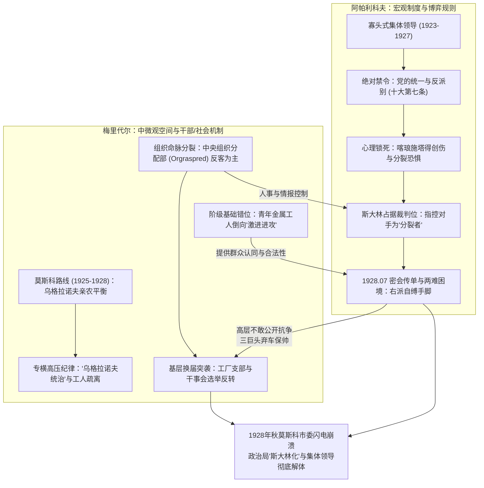

# 深度对读札记：莫斯科市委溃败与政治局权力规则的终结（1925–1929）
## 梅里代尔（Catherine Merridale, 1990）与阿帕利科夫（Дмитрий Апальков, 2023）对读

- **对读文献 A**: 凯瑟琳·梅里代尔《莫斯科政治与斯大林崛起：首都的共产党 1925–32》（Catherine Merridale, *Moscow Politics and the Rise of Stalin: The Communist Party in the Capital, 1925-32*, 1990；对应中译整理本 `sources/monographs/merridale_1990_moscow_politics_zh/`）
- **对读文献 B**: 德米特里·阿帕利科夫《联共(布)党内斗争：从“集体领导”到斯大林个人统治》（Д. И. Апальков, *Внутрипартийная борьба в ВКП(б): от «коллективного руководства» к личному единовластию И. В. Сталина*, 2023；对应中译整理本 `sources/monographs/apalkov_intra_party_struggle_zh/`）
- **执笔官**: 全文精读与论断提炼官（close-reader）
- **落款日期**: 2026-11-18
- **核心论题**: 1928年秋莫斯科党委（MK）在短短数周内向斯大林闪电瓦解的基层/干部机制，与1923–1929年政治局“集体领导”博弈规则演进及右翼反对派崩溃机制之微观—宏观立体对读。

---

## 一、双重视角的问题意识与互补结构

在苏维埃政治史与斯大林崛起的研究脉络中，传统的解释往往陷入两种单一维度的局限：一种是西方早期极权主义学派（以及部分政治传记）的“顶层阴谋与机关全能论”，认为斯大林单凭中央书记处的干部任命权（Nomenklatura）和个人马基雅维利式的权谋便自动决定了斗争胜负；另一种则是传统社会史修正派（如希拉·菲茨帕特里克等）强调的“自下而上的社会激进主义”，认为新经济政策的妥协必然引发城市工人的敌视与阶级斗争冲动。

本对读通过将**凯瑟琳·梅里代尔（Catherine Merridale）**的中微观空间/干部机制研究与**德米特里·阿帕利科夫（Dmitry Apalkov）**的宏观高层制度/规则研究置于同一分析框架下，展现了斯大林击溃右翼反对派（布哈林—李可夫—托姆斯基）与夺取首都莫斯科的真实机制：

- **阿帕利科夫提供了制度与博弈规范的“硬约束边界”**：深入解构了列宁去世后布尔什维克最高权力的寡头属性——政治局“集体领导”并非民主制，而是一套高度忌惮公开争论、将“新喀琅施塔得”式的分裂视为亡党梦魇的寡头自我平衡系统。该规则赋予指控他人为“分裂者/宗派分子”的一方以压倒性道德与制度优势。
- **梅里代尔提供了中层干部与基层土壤的“操作现场”**：揭示了莫斯科作为全国最大党组织和经济中枢，其地方党委（MK）并非独立诸侯。乌格拉诺夫治下的莫斯科路线在政策上支持渐进新经济政策，但在体制上推行比中央更严苛的官僚集权；斯大林通过安插在莫斯科市委内的组织分配部（Orgraspred）及其操纵的基层支部选举，在短短数周内将乌格拉诺夫的干部基础连根拔起。

---

## 二、乌格拉诺夫在莫斯科的执政机制（1925–1928）：温和NEP政策与专横官僚统治的错位

### 2.1 “莫斯科路线”的实质与亲农取向
根据梅里代尔的考察，在1924年底取代泽连斯基执掌首都党委后，尼古拉·乌格拉诺夫逐步确立了一条鲜明的“莫斯科路线”：
1. **产业结构的轻工业优先论**：莫斯科作为历史上的“印花布莫斯科”（Calico Moscow），其工业命脉是纺织业。乌格拉诺夫极力捍卫现有轻工业和纺织工业的发展，反对“不负责任的”向重工业盲目倾斜的资本积累速度，主张遵循布哈林的“平衡增长”模式 `[Merridale, ch05, pp. 41, 53]`。
2. **农村政策的妥协与容忍富农**：莫斯科党组织紧跟布哈林，强调必须维持工农联盟（*smychka*），安抚农民。乌格拉诺夫在党内以容忍富农著称，甚至直到1928年2月仍公开将富农亲昵地称为“我们亲爱的小富农”（*kulachishka*）`[Merridale, ch05, p. 53]`。
3. **企业管理维护“一长制”**：在工厂内部，乌格拉诺夫主张严格恪守厂长、工会与党支部的“三角关系”（*troika*），甚至公开维护工厂管理层对抗基层党细胞与工会干预的特权，抵制工人“从生产一线”（*vydvizhenie*）直接提拔到管理岗位，以防影响生产效率 `[Merridale, ch05, pp. 53-54]`。

### 2.2 “乌格拉诺夫统治”（Uglanovshchina）与工人阶级的深刻疏离
然而，乌格拉诺夫在政策上的温和渐进，并未换来莫斯科工人阶级对其政权的认同，反而制造了毁灭性的政治真空：
- **生活水平受挫与严苛紧缩**：1925–1926年推行的“节约制度”（regime of economy）直接导致莫斯科各行业工资削减高达13%–30%，同时伴随着极高的失业率（1927年莫斯科产业工人中每4人就有1人失业，失业大军超11万人）`[Merridale, ch05, pp. 34, 44, 54]`。大量涌入城市的季节性农民工（*otkhodniki*）与本地失业工人加剧了恶劣的住房与生活危机。
- **专横集权与对党内民主的扼杀**：乌格拉诺夫对联合反对派进行了无情残酷的清洗（1924年春清洗22.2%的高校党员，1926–1927年动用GPU对反对派集会和地下印刷所铁腕围剿）`[Merridale, ch05, pp. 40, 46]`。在党内，他用极度集权的官僚命令定义“民主集中制”，下级组织的主动权被剥夺殆尽。
- **工人的怨恨与冷漠**：在首都工人和基层党员看来，1920年代中期的恶劣生活与对批评的无情压制被称为“乌格拉诺夫统治”（*Uglanovshchina*）`[Merridale, ch05, p. 54]`。当1928年粮食收购危机引发面包短缺和配给制阴影时，莫斯科工人既无法从“亲农”的新经济政策中获益，又对乌格拉诺夫毫无好感。当1928年秋党内决战来临时，乌格拉诺夫根本无法指望莫斯科无产阶级提供任何阶级掩护。

---

## 三、阿帕利科夫视角下的政治局博弈规则：集体领导的自毁机制（1923–1929）

阿帕利科夫对1920年代苏联最高权力运行的剖析，为理解莫斯科市委的孤立无援提供了制度性解答。

### 3.1 “集体领导”的寡头属性与“喀琅施塔得创伤”
阿帕利科夫指出，“集体领导”本质上是列宁退出政坛后建立在政治局与中央委员会政治主体地位之上的**寡头共治体制** `[Apalkov, ch03, p. 20]`：
1. **两层权力架构**：第一层是政治局最具声望的核心小团体（托洛茨基、斯大林、加米涅夫、季诺维也夫、布哈林，以及李可夫和托姆斯基）；第二层是由中央委员、中监委和地方核心首脑（如莫斯科、列宁格勒、乌克兰等）构成的20–30人骨干群体 `[Apalkov, ch03, p. 21]`。
2. **绝对神圣的铁律——“党的统一”**：在布尔什维克精英的意识深处，工会争论引发的纪律涣散与1921年喀琅施塔得水兵暴动的爆发被永久绑定在一起。高层分裂意味着政治垄断的终结和“新喀琅施塔得”的重演。因此，俄共（布）十大通过的《关于党的统一》决议（尤其是第七条允许以三分之二多数开除中央委员乃至政治局委员的规定），在党内政治文化中确立了：**任何具有特殊政纲、建立集团纪律的派别活动均属不可饶恕的死罪** `[Apalkov, ch03, pp. 24-27]`。

### 3.2 规则的反讽：反对派的“民主呼吁”必遭反噬
阿帕利科夫深刻论证道：“反对派的民主辞令与‘集体领导’的规矩相矛盾……在布尔什维克专政框架内为党内民主而进行的斗争是注定要失败的” `[Apalkov, ch11, p. 192]`。
- 托洛茨基（1923）、季诺维也夫与加米涅夫（1925）、布哈林与李可夫（1928–1929）都在掌权占据多数时极力主张“铁的纪律”并严酷整肃少数派；唯有在自身沦为少数并濒临失势时，才突然高呼“党内民主”与“工人民主”。这种投机性与滞后性，使得全党骨干对反对派的“民主”呼吁充满鄙夷与冷漠。
- 更为致命的是，**这一规则赋予了掌控党内审查与纪律机关的“中间派多数”（斯大林）无可匹敌的道德制高点**。斯大林只需将自己塑造成“党内统一与铁的纪律的捍卫者”，而将任何政策异见打成“破坏统一、企图分裂的宗派”，就能动员广大害怕内讧的中央委员。

### 3.3 1928年转折点：粮食危机与右翼的三重瘫痪
1928年春斯大林推行“非常措施”（强行征粮、搜查农户、关闭集市），引发高层剧震。在1928年7月中央全会上，布哈林和李可夫凭借农民骚动剧增（1928年4–6月发生446起农民骚乱）和红军士兵士气动摇的警报，一度迫使全会一致通过禁止重复非常措施的决议，取得形式上的胜利 `[Apalkov, ch08, pp. 134-135]`。
然而，右翼随后陷入了致命的三重瘫痪：
1. **斗争策略的自我缴械（不愿也不敢成为“分裂者”）**：布哈林对加米涅夫哀叹：“我们应该开始争论吗？他们为这个会杀了我们！中央害怕争论” `[Apalkov, ch08, p. 127]`。右翼绝不敢公开成立派系，只能在党内使用含混隐晦的“寓言式语言”（Aesopian language），甚至极力向党内群众否认政治局存在分歧。
2. **中间派同盟的崩塌**：加里宁和伏罗希洛夫在7月全会关键时刻迅速倒向斯大林；米高扬与奥尔忠尼启则虽主张妥协，但中监委主席奥尔忠尼启则的职责是“维护党的统一”，只要布哈林未公开举旗，奥尔忠尼启则便充当和事佬，而一旦出现分裂苗头，中监委便直接沦为审判机器 `[Apalkov, ch08, pp. 138-140, 146-147]`。
3. **“密会传单”的政治自杀**：1928年7月布哈林因极度恐慌私下密会加米涅夫，试图联手抗斯。加米涅夫的谈话记录在1929年1月被托洛茨基派以传单形式印发。阿帕利科夫利用此前未公开的1929年1–2月政治局与中监委联席会议速记档案证实：这份材料被斯大林和奥尔忠尼启则定性为“与被开除的宗派分子暗中勾结”，在道德与政治纪律上彻底摧毁了布哈林的合法性，使右翼在1929年4月全会上彻底万劫不复 `[Apalkov, ch09, pp. 150-157]`。

---

## 四、1928年秋莫斯科市委闪电崩溃的基层与干部机制（对读合成）

为什么莫斯科作为右倾偏向最核心的根据地，未能在1928年秋成为抵御斯大林专权的坚固堡垒，反而在短短几周内（1928年9月至10月）彻底解体投降？将梅里代尔的档案考据与阿帕利科夫的高层政治动力相结合，可以清晰还原出其微观运作链条：

### 4.1 干部机制：中央组织分配部（Orgraspred）的“特洛伊木马”
梅里代尔的扎实研究揭示了莫斯科党政架构内部致命的制度裂痕：
- **宣传部门 vs 组织部门的权力割据**：乌格拉诺夫的右翼盟友（曼德尔施塔姆、柳廷、佩尼科夫）虽然掌控了莫斯科市委的宣传鼓动部（Agitpropotdel）以及两份官方大报《共产党员手册》与《工人莫斯科报》，但这只是“笔杆子”；
- **斯大林对组织分配部的绝对控制**：真正掌管干部选拔、调配和任免的战略要害——莫斯科市委组织分配部（*orgraspredotdel*），自1925年起就长期由斯大林一手栽培的亲信**卡尔·鲍曼（Karl Bauman）**把持；1928年5月鲍曼调升中央后，又由斯大林派**V. I. 波隆斯基（Polonsky）**接任，其副手齐夫里诺维奇则于6月出任鲍曼区委书记 `[Merridale, ch05, p. 55]`。
- **自下而上的换届政变**：当1928年夏秋乌格拉诺夫在《工人莫斯科报》上发表文章反抗斯大林路线时，波隆斯基等人已经利用组织分配部的职权，直接操纵了莫斯科全市工厂与行政机关基层党小组干事会（*byuro*）的常规选举，将忠于斯大林路线的骨干批量送入基层领导岗位 `[Merridale, ch05, p. 59]`。到了10月中旬，当乌格拉诺夫试图行使第一书记权力撤换倒戈的区委干部（如拉齐扬、阿尔费罗夫）时，中央书记处直接出面否决了莫斯科市委的决定！

### 4.2 高层博弈的反噬：右翼三巨头的“弃车保帅”
阿帕利科夫的高层分析与梅里代尔的地方史在这里完全吻合：
- 面对斯大林在莫斯科发起的迅猛攻势，布哈林、李可夫和托姆斯基在政治局中采取了退缩策略。为了在中央全会和报刊上为冲突降温、避免被正式指控为组建反党集团，政治局右派三巨头在1928年9–10月“有意抛弃了乌格拉诺夫，允许斯大林吞噬莫斯科右倾分子，以换取他们自己的喘息时间” `[Merridale, ch05, p. 58; Apalkov, ch08, p. 143]`。
- 丧失中央政治掩护的乌格拉诺夫陷入了彻头彻尾的孤立。他在10月2日低头起草认错信，并在10月18–19日的莫斯科委员会全会上被迫承认“严重错误”；斯大林与莫洛托夫亲临全会施压，当场撤换柳廷、佩尼科夫、曼德尔施塔姆与莫罗兹，并在11月以莫洛托夫亲自接管莫斯科市委第一书记职务，彻底完成清算 `[Merridale, ch05, pp. 59-60]`。

### 4.3 阶级机制：激进青年工人的动员与“大转变”的社会同盟
斯大林在莫斯科的胜利不能仅仅归结为干部手腕。梅里代尔深入分析了基层党员与工人阶级在1928年秋的真实心态：
- **斯大林激进路线的社会诱惑**：经过长达十年的粮食收购混乱、高失业和商业投机，斯大林在1928年提出的“向资本主义分子发起社会主义全面进攻”虽然充满风险，但在城市工人眼中却展现出打破沉闷僵局的曙光。“如果我们的命运如此糟糕，我们究竟为什么而战，为什么要流血？”`[Merridale, ch05, p. 62]`。工人们普遍认为，工业化的牺牲应当由“富裕的农民”来承担，而不是继续克扣城市工人的口粮。
- **金属工人与纺织工人的社会分化**：在莫斯科，最有可能入党并积极参政的是机械制造和金属加工行业（如阿莫汽车厂、镰刀与锤子厂）的年轻男性工人，他们文化程度高、无土地牵绊，是斯大林激进工业化与“文化革命”的狂热支持者；相反，同情新经济政策、留恋农村土地的群体则集中在年长、文盲率高的女性纺织工人以及季节性农民工中，而这部分人恰恰最缺乏政治组织能力和话语权 `[Merridale, ch07, pp. 107-109]`。
- **来自下层的真实投决**：在10月份莫斯科各区和工厂支部的会议上，积极分子对“乌格拉诺夫统治”投出的反对票，在很大程度上是真诚的阶级仇恨与激进主义的表达。这种下层激进主义不仅摧毁了右派在莫斯科的立足点，而且为随后开展的超高速工业化与暴力全盘集体化提供了最初的政治动能。

---

## 五、综合史学启示：两书对读的立体透镜

| 维度 | 阿帕利科夫（Apalkov, 2023） | 梅里代尔（Merridale, 1990） | 交叉对读结论 |
| :--- | :--- | :--- | :--- |
| **核心分析场域** | 克里姆林宫政治局、中央全会、中监委联席会议 | 莫斯科市委（MK）、区委（Raikom）、工厂车间支部 | 斯大林的胜利是中央书记处人事权力穿透并瓦解地方堡垒的过程 |
| **关键解释机制** | “集体领导”的寡头规则与反派别禁令所造成的反向自缚 | 组织分配部（Orgraspred）的基层选举渗透与干部调配垄断 | 顶层制度禁令使右派不敢呼吁群众；中层组织渗透使右派无法掌控干部 |
| **对待新经济政策** | 政治局内部围绕“贡税论”与非常措施的路线摊牌 | 首都面临的纺织危机、25%失业率与“乌格拉诺夫统治”民怨 | NEP在经济逻辑上的可行性，被城市基层严重的民生危机与意识形态敌视抵消 |
| **群众与社会的作用** | 群众被排除在寡头博弈外，但红军与农民骚乱构成高层心理红线 | 青年熟练产业工人的激进主义为斯大林提供了关键的社会支持力量 | 斯大林不仅精于机关权术，而且敏锐捕捉并释放了城市工人的激进阶级冲动 |
| **权力转型的终局** | 政治局彻底斯大林化，合议制制衡消失，滑向个人独裁 | 鲍曼激进政权的“极左过火”与首都被完全置于中央极权监控之下 | 地方独立自主性的丧失是全苏联政治体制转向一元极权体制的决定性环节 |

通过对读可见，1928年莫斯科市委的溃败，既不是一场纯粹的顶层密室政变，也不是自发阶级意志的自然产物，而是**布尔什维克“集体领导”寡头规则的内在结构性死结，与中央书记处对基层干部网络的垂直渗透，以及城市青年工人阶级激进主义三者交汇共振的历史必然产物**。这一事件标志着布尔什维克党内最后一个拥有区域组织实体和独立政策纲领的政治派别被彻底歼灭，为斯大林在1929年底建立无制衡的个人独裁扫清了最后的制度障碍。
