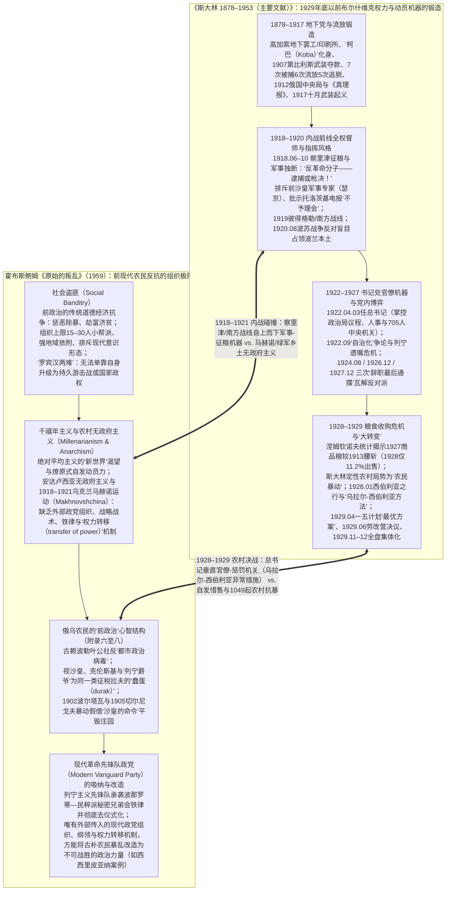

# 深度对读札记：1929年底以前的斯大林解密核心档案与霍布斯鲍姆“古朴叛乱—现代政党”张力模型

> **时间与考据边界声明**：本札记严格遵循任务指令，对《斯大林 1878–1953（主要文献）》的精读与引证严格限定于 **1929年底以前**（即 PDF 第1–156页，外加第164页所载 `1929-06-27` 政治局关于建立劳动改造营的决议），绝不越界使用1930年以后的档案材料推导1929年底以前的结论；对霍布斯鲍姆《原始的叛乱》（1959）的精读聚焦于“前政治（pre-political）”农民社会盗匪、千禧年主义/农村无政府主义与现代革命先锋队政党组织逻辑之间的结构性张力，并以其附录收录的乌克兰马赫诺运动（`Makhnovshchina`）及俄国农村起义史料作为比较参照。

---

## 一、 论证结构图（Argumentation Structure）

---

## 二、 核心论断与一字不差原文直引（Core Claims & Verbatim Quotes）

### （一） 1917年以前：从高加索地下“柯巴”到布尔什维克中央俄国局实务核心

1. **生辰档案考辨与早年革命化**：
   - 戈里圣母升天大教堂出生与受洗登记簿确证，约瑟夫·朱加什维利生于 `1878-12-06 [O.S.] / 1878-12-18 [N.S.]`（而非1922年秘书代填问卷后确立的官方生日 `1879-12-09 [O.S.] / 1879-12-21 [N.S.]`）。文献编者直引档案说明：
   > “在戈里圣母升天大教堂的出生登记簿上写着：1878年12月6日，农民维萨里昂·伊万诺维奇·朱加什维利及其合法妻子叶卡捷琳娜·格奥尔基耶夫娜生有一子约瑟夫（旧历12月6日相当于新历12月18日）。他在两周后受洗。几乎所有由他亲自填写的革命前及革命后的调查表，以及警察局的文件中，都记录着这个日期。但在1922年，一份由他助手填写的问卷中，首次出现了另一个日期——1879年12月9日（21日）。”
   > — [ch00_pages_1-30.md](file:///C:/Users/lsaax/.t3/projects/russian-revolution-knowledge-base/sources/primary/stalin_major_documents_zh/ch00_pages_1-30.md#L254-L261) `[PDF p. 11]`

2. **“柯巴（Koba）”化名与高加索地下武装“夺款（Expropriations）”**：
   - 1904年越狱返回高加索后，朱加什维利采用亚历山大·卡兹别吉小说《弑父者》中复仇山民盗匪英雄的名字“柯巴”作为党内化名，组织巴库与第比利斯罢工、秘密印刷所（阿夫拉巴尔印刷所）、战斗队与武装银行劫款（如 `1907-06-13 [O.S.] / 1907-06-26 [N.S.]` 卡莫带队实施的第比利斯埃里温广场运钞马车劫案，劫得25万卢布）：
   > “他的文章末尾署名‘科……’或‘柯巴’。在格鲁吉亚作家亚·卡兹别吉的小说《弑父者》中，那位为人民幸福而战的复仇者主人公就叫这个名字。柯巴也成了朱加什维利在党内的化名。”
   > — [ch01_pages_31-60.md](file:///C:/Users/lsaax/.t3/projects/russian-revolution-knowledge-base/sources/primary/stalin_major_documents_zh/ch01_pages_31-60.md#L28-L31) `[PDF p. 31]`
   > “他组织罢工，散发传单，领导巴库布尔什维克委员会，建立战斗队。他们袭击警察、宪兵，抢劫银行、邮政列车、轮船。抢劫所得用于购买武器、印刷机、资助流亡者。在一次行动中，柯巴的助手卡莫（西蒙·特尔-彼得罗相）表现尤为突出。1907年6月13日，在第比利斯市中心的埃里温广场，卡莫的战斗队袭击了运送25万卢布的邮政马车。炸弹爆炸，枪声大作，造成数十人死伤，但钱被抢走了，战斗队员全身而退。”
   > — [ch01_pages_31-60.md](file:///C:/Users/lsaax/.t3/projects/russian-revolution-knowledge-base/sources/primary/stalin_major_documents_zh/ch01_pages_31-60.md#L89-L97) `[PDF p. 33]`

3. **地下韧性、1912年俄国中央局与“奥赫兰那密探”伪件考证**：
   - 1902至1913年间，斯大林共被捕7次、流放6次、成功逃脱5次（仅最后一次即 `1913-02-23 [O.S.]` 被捕流放图鲁汉斯克边疆区至1917年二月革命后才获释，见 [ch02_pages_61-90.md](file:///C:/Users/lsaax/.t3/projects/russian-revolution-knowledge-base/sources/primary/stalin_major_documents_zh/ch02_pages_61-90.md#L128-L174) `[PDF pp. 65–66]`）。1912年1月布拉格代表会议后，列宁提名将斯大林缺席增补进中央委员会并任命为俄国中央局领导人，并于 `1912-04-22 [O.S.] / 1912-05-05 [N.S.]` 创办《真理报》（[ch01_pages_31-60.md](file:///C:/Users/lsaax/.t3/projects/russian-revolution-knowledge-base/sources/primary/stalin_major_documents_zh/ch01_pages_31-60.md#L465-L471) `[PDF p. 46]`，[ch01_pages_31-60.md](file:///C:/Users/lsaax/.t3/projects/russian-revolution-knowledge-base/sources/primary/stalin_major_documents_zh/ch01_pages_31-60.md#L539-L554) `[PDF p. 49]`）。
   - 针对流传甚广的 `1913-07-12 [O.S.]` 所谓警察局特别部主任叶列明上校致叶尼塞省宪兵主任信函（指控斯大林自1906年起充当奥赫兰那密探），俄罗斯国家档案馆（GARF）专家季·伊·佩列古多娃通过公文程式、编号规则与笔迹鉴定（确认为远东白卫流亡军官弗·鲁西亚诺夫上尉伪造并售予美国记者艾·唐·列文）彻底证伪（[ch01_pages_31-60.md](file:///C:/Users/lsaax/.t3/projects/russian-revolution-knowledge-base/sources/primary/stalin_major_documents_zh/ch01_pages_31-60.md#L713-L772) `[PDF pp. 55–56]`）。

4. **1917年十月起义与早期反联邦制集权观**：
   - `1917-03-12 [O.S.] / 1917-03-25 [N.S.]` 斯大林自阿钦斯克返回彼得格勒，三天内接管《真理报》并进入中央局（[ch02_pages_61-90.md](file:///C:/Users/lsaax/.t3/projects/russian-revolution-knowledge-base/sources/primary/stalin_major_documents_zh/ch02_pages_61-90.md#L198-L226) `[PDF p. 68]`）；在 `1917-03-28 [O.S.]` 发表的《反对联邦制》中，斯大林明确揭示其大一统中央集权底色：
   > “难道不清楚吗，联邦制在俄国不能解决也不可能解决民族问题，它只会使这个问题纠缠不清和更加复杂化，因为它是企图使历史的车轮倒转？……”
   > — [ch02_pages_61-90.md](file:///C:/Users/lsaax/.t3/projects/russian-revolution-knowledge-base/sources/primary/stalin_major_documents_zh/ch02_pages_61-90.md#L446-L450) `[PDF p. 77]`

---

### （二） 1918–1920年内战：察里津冲突、战线督师与波苏战争电报（对应 `CLM-stalin-docs-tsaritsyn-and-civil-war-command-style`）

1. **察里津征粮全权督师（1918年6月）**：
   - `1918-05-29` 人民委员会任命斯大林为俄国南部粮食事务总负责人；`1918-06-04` 斯大林率400名红军抵达察里津，以铁腕管制、固定粮价与军事押运在一周内向莫斯科发运100万普特粮食。`1918-06-16` 斯大林自察里津致电列宁：
   > “我们已占领穆兹加、阿列克西科沃和乌留皮诺，铁路交通也已恢复。今天向莫斯科和北方发送五十万，即半百万普特粮食。其中十万普特正在阿尔切达和菲洛诺沃之间运输，其余正从察里津车站发出。车次将另行通知。需要四十台燃煤机车，我们有煤。我已两次向五人委员会提出。沃罗涅日方面没有答复，而那里有整整一堆多余的机车。请采取措施。人民委员斯大林”
   > — [ch02_pages_61-90.md](file:///C:/Users/lsaax/.t3/projects/russian-revolution-knowledge-base/sources/primary/stalin_major_documents_zh/ch02_pages_61-90.md#L593-L605) `[PDF p. 82]`

2. **察里津军事指挥风格、反军事专家（`voenspetsy`）及与托洛茨基的正面冲突（1918年7–10月）**：
   - `1918-07-07` 斯大林致信列宁索要军事全权：“既然没有给，那我自己就顺便把军事全权拿过来了……”（`[PDF p. 83]`）。在察里津防卫战中，斯大林将地下时代的果决转化为前线生杀大权，并公然抗拒托洛茨基派来的前沙皇将军彼·瑟京（P. P. Sytin）：
   > “在察里津，斯大林习惯了穿军装、靴子。他不愿在任何方面落后于红军指挥官——无论是言辞的激烈程度、指挥员的做派，还是在决定人的命运时的迅速果断：反革命分子——逮捕或枪决！”
   > — [ch02_pages_61-90.md](file:///C:/Users/lsaax/.t3/projects/russian-revolution-knowledge-base/sources/primary/stalin_major_documents_zh/ch02_pages_61-90.md#L638-L644) `[PDF p. 84]`
   > “斯大林对前沙皇军官明显不信任，这导致他与革命军事委员会主席托洛茨基发生冲突。斯大林可以毫不在意地在革命军事委员会主席的指示电报上批示：‘不予理会’。托洛茨基要求列宁：‘坚决坚持召回斯大林……’”
   > — [ch02_pages_61-90.md](file:///C:/Users/lsaax/.t3/projects/russian-revolution-knowledge-base/sources/primary/stalin_major_documents_zh/ch02_pages_61-90.md#L660-L667) `[PDF p. 85]`
   > “他甚至原谅了柯巴拒绝接受托洛茨基派来的方面军指挥官、军事专家彼·瑟京，这是对共和国革命军事委员会前所未有的抗命。如果是其他任何一位人民委员这样做，他的政治生涯就会终结。1918年10月，柯巴成为共和国革命军事委员会委员，11月进入工农国防委员会。如果再补充一点，他还是中央委员、组织局和政治局委员，以及人民委员部成员，那么察里津之后，斯大林的政治分量翻了一番。”
   > — [ch02_pages_61-90.md](file:///C:/Users/lsaax/.t3/projects/russian-revolution-knowledge-base/sources/primary/stalin_major_documents_zh/ch02_pages_61-90.md#L677-L690) `[PDF p. 85]`

3. **1919年彼得格勒/南方战线与1920年波苏战争中的战略分歧**：
   - `1919-06-16` 斯大林在攻克叛乱的“红山”炮台后致电列宁，嘲讽海军专家的作战教条：“海战科学要求做与它本身要求相反的事情。因此，我不得不像在察里津一样，无视海战科学，把自己的意志强加给海军人员……”（[ch02_pages_61-90.md](file:///C:/Users/lsaax/.t3/projects/russian-revolution-knowledge-base/sources/primary/stalin_major_documents_zh/ch02_pages_61-90.md#L767-L793) `[PDF p. 90]`）。
   - 然而，在1920年夏波苏战争（`1920-08-19` 政治局会议记录）中，解密档案推翻了传统将华沙战败单纯归咎于斯大林“贪功抗命”的单一叙事，揭示斯大林在西南方面军反而警告克里姆林宫不要因迷信“波兰革命”而盲目占领波兰本土：
   > “在辉煌胜利的狂热和对波兰革命的期待中，克里姆林宫已着手筹备俄共（布）中央波兰局。斯大林反对占领真正的波兰领土。他在西南方面军徒劳地发出警告，要求清醒评估形势，拒绝将政治考量引入军事战略。无论是列宁和中央委员会，还是最高统帅部，都未对斯大林的热切呼吁采取行动。”
   > — [ch03_pages_91-120.md](file:///C:/Users/lsaax/.t3/projects/russian-revolution-knowledge-base/sources/primary/stalin_major_documents_zh/ch03_pages_91-120.md#L68-L78) `[PDF p. 93]`
   > “但随后内战结束了。斯大林是三位获胜的领导人之一，他们的地位尤其得到了巩固。因此，试图将斯大林描绘成一个意外获得权力的平庸党务官僚，是根本错误的。即使柯巴在1920年底去世，他的名字也依然会被载入共产党的史册。在俄共（布）第八次代表大会的中央委员选举中，他只比列宁少几票：列宁——262票，斯大林——258票，托洛茨基——219票...”
   > — [ch03_pages_91-120.md](file:///C:/Users/lsaax/.t3/projects/russian-revolution-knowledge-base/sources/primary/stalin_major_documents_zh/ch03_pages_91-120.md#L123-L136) `[PDF p. 95]`

---

### （三） 1922–1929年：中央书记处权力机器、辞职最后通牒与粮食危机指令（对应 `CLM-stalin-docs-1920s-secretariat-correspondence-and-grain-turn`）

1. **1922年4月3日总书记职务的制度化赋权**：
   - `1922-04-03` 俄共（布）中央全会选出斯大林任新设的中央委员会总书记（莫洛托夫、古比雪夫任书记）。斯大林迅速将书记处从技术性秘书机构改造为垂直党国中枢：
   > “4月3日，他被选为中央委员会总书记，同时仍兼任两人民委员部首脑。斯大林自此掌握政治局会议议程制定、人事问题决策以及当时庞大的中央机构（705人）的管理权。自4月6日起，政治局几乎总在周四以全员出席（此前未有之情况）的方式召开会议。斯大林确立了上级组织对下级组织不懈监督及决议执行的原则，建立了自上而下的党的权力体系。”
   > — [ch03_pages_91-120.md](file:///C:/Users/lsaax/.t3/projects/russian-revolution-knowledge-base/sources/primary/stalin_major_documents_zh/ch03_pages_91-120.md#L318-L330) `[PDF p. 101]`

2. **三次“辞职最后通牒”（1924.08 / 1926.12 / 1927.12）的政治操控术**：
   - 面对列宁《给代表大会的信》（1922年12月–1923年1月）曝光后的威信危机，斯大林先后于 `1924-08-19`、`1926-12-27` 和 `1927-12-19`（联共（布）十五大后的中央全会）三次提出辞去总书记职务，逼迫政治局与中央全会以全票（或仅1票弃权）挽留，从而将职务合法性转化为对反对派的政治清退：
   > “斯大林的威信受到打击，他请求辞职。实质上，这不是请求，而是最后通牒。许多历史学家认为，斯大林在写声明时就明白，不会让他辞职。事实也是如此，所有人都投票反对——包括加米涅夫和季诺维也夫。”
   > — [ch03_pages_91-120.md](file:///C:/Users/lsaax/.t3/projects/russian-revolution-knowledge-base/sources/primary/stalin_major_documents_zh/ch03_pages_91-120.md#L826-L833) `[PDF p. 119]`
   > “接下来，让我们看看全会会议速记：‘李可夫。……现在表决斯大林关于解除其总书记职务的提议。谁赞成这个提议？谁反对？谁弃权？一人。’”
   > — [ch04_pages_121-150.md](file:///C:/Users/lsaax/.t3/projects/russian-revolution-knowledge-base/sources/primary/stalin_major_documents_zh/ch04_pages_121-150.md#L236-L239) `[PDF p. 130]`

3. **1927–1928年粮食收购危机、涅姆钦诺夫统计与斯大林西伯利亚之行（1928年1月）**：
   - 档案揭示了斯大林在1927年底至1928年初从温和立场突变为推行非常措施与集体化的两大直接触发机制——农村惜售引发的“农民暴动”定性与统计学家В·涅姆钦诺夫（V. S. Nemchinov）关于商品粮率结构性坍塌的报告：
   > “例如，在收成好的1926年，生产了6550万吨粮食（比革命前的农民多近2500万吨），却仅向国家出售了740万吨。无论是给地方党的工作人员的指示，还是对投机倒把分子（试图在市场上卖粮者）的审判都无济于事。农民既不急于与政权分享粮食，也不急于分享忠诚，并且以减少谷物播种面积来回应克里姆林宫的强制行动。斯大林不得不将农村形势称为‘农民暴动’。作为回应，克里姆林宫决定开展粮食征收运动。政治局成员被派往主要产粮区。斯大林本人则前往西伯利亚。”
   > — [ch04_pages_121-150.md](file:///C:/Users/lsaax/.t3/projects/russian-revolution-knowledge-base/sources/primary/stalin_major_documents_zh/ch04_pages_121-150.md#L511-L527) `[PDF p. 139]`
   > “斯大林在西伯利亚度过了三周。这些日子主要被与地方领导人的会议和党的积极分子会面所占据。他的讲话是坚决的：‘必须这样打击富农，让中农在我们面前站直。’在斯大林的压力和惩罚机关的参与下，从西伯利亚运出粮食的极其紧张的计划被通过并执行了。……根据斯大林的观点，社会主义建设要求对富农进行‘阶级斗争尖锐化’。从1928年2月起，他开始推行‘乌拉尔-西伯利亚’的粮食收购方法。在西伯利亚试验的这套非常措施体系开始在全国推广。”
   > — [ch04_pages_121-150.md](file:///C:/Users/lsaax/.t3/projects/russian-revolution-knowledge-base/sources/primary/stalin_major_documents_zh/ch04_pages_121-150.md#L538-L555) `[PDF p. 140]`
   > “早在1927年11月，斯大林还谈到集体化是‘还不会很快到来’的事情。突然一个月后，在联共（布）第十五次代表大会上，他宣布这是紧迫任务。斯大林观念上的转变发生在了解了杰出经济学家В·涅姆钦诺夫的研究之后。革命后大型农场的被消灭不可避免地导致，1927年的商品粮（用于出售的粮食）数量比1913年少了整整一倍（！），而粮食总产量大致相等。涅姆钦诺夫指出，革命前超过70%的商品粮是由大量使用雇佣工人的大型农场提供的。到1928年，农民（总体而言）生产的粮食增加了近40%，但几乎全部被自己消费：只有11.2%的收成用于出售。”
   > — [ch04_pages_121-150.md](file:///C:/Users/lsaax/.t3/projects/russian-revolution-knowledge-base/sources/primary/stalin_major_documents_zh/ch04_pages_121-150.md#L578-L596) `[PDF p. 142]`

4. **1929年“大转变”制度闭环：一五计划“最优方案”、劳改营体系与全盘集体化**：
   - `1929-04-23` 联共（布）第十六次代表会议在斯大林与最高国民经济委员会主席古比雪夫推动下，否决国家计划委员会的谨慎“起始方案”，强行通过工业化“最优方案”（[ch04_pages_121-150.md](file:///C:/Users/lsaax/.t3/projects/russian-revolution-knowledge-base/sources/primary/stalin_major_documents_zh/ch04_pages_121-150.md#L621-L678) `[PDF pp. 143–144]`）。
   - `1929-06-27` 政治局通过决议建立国家政治保卫总局（OGPU）劳动改造营体系：“……转为付费大规模利用刑期不少于三年的刑事犯劳动力的制度。”（首个营地建于乌赫塔，见 [ch05_pages_151-180.md](file:///C:/Users/lsaax/.t3/projects/russian-revolution-knowledge-base/sources/primary/stalin_major_documents_zh/ch05_pages_151-180.md#L307-L320) `[PDF p. 164]`）。
   - `1929-11` 至 `1929-12-27` 斯大林推翻同年4月十六次代表会议规定的“到1933年集体化播种面积占17.5%”的温和目标，宣布转入“全盘集体化”与“消灭富农阶级”（[ch05_pages_151-180.md](file:///C:/Users/lsaax/.t3/projects/russian-revolution-knowledge-base/sources/primary/stalin_major_documents_zh/ch05_pages_151-180.md#L127-L148) `[PDF pp. 156–157]`）。

---

### （四） 霍布斯鲍姆《原始的叛乱》（1959）：前现代农民古朴反抗与现代先锋队政党的张力（对应 `CLM-hobsbawm-1959-archaic-peasant-rebellion-vs-modern-party`）

1. **“社会盗匪（绿林好汉）”的保守改革主义本质与组织天花板**：
   > “绿林好汉（第二章）这个全球性的且本质上是永恒不变的现象，实无过于是土著农民反抗压迫与贫困的抗争：一声报复富人与压迫者的呐喊、一场对富人与压迫者加上某些管束的模糊美梦、一次惩恶除暴。其企图是微薄的：一个人人各得其份的传统世界，而非一个完美的新世界。……绿林好汉不追随任何组织或意识形态，与现代社会运动完全无法相容。”
   > — [ch04_第一章_导论.md](file:///C:/Users/lsaax/.t3/projects/russian-revolution-knowledge-base/sources/monographs/hobsbawm_1959_primitive_rebels_zh/ch04_第一章_导论.md#L17) `[epub:text/part0006_split_000.html]`
   > “若要成为其支持民众的有效守护者，盗匪必须停止做盗匪：这是现代罗宾汉的两难困境。……因此，1905年布赫沃斯托瓦（Bykhvostova）地方乌克兰人村落的农民运动，主要是由哥萨克人瓦西里·波塔潘科（Vassili Potapenko，他手下那伙人的‘沙皇’）、农夫皮尤特·谢列莫科（Pyotr Cheremok，他的‘大臣’）、他们手下的帮众……这些代表了穷人与无土地农民，以及反对个人主义与圈地者的社区意识的小帮派，后来被一个富农（kulaks）的农村反革命运动所杀。尽管如此，帮派终究不能成为革命化农民的持续性组织形式，它最多只能当成除此之外别无他法加以组织的农民之暂时性辅助工具。”
   > — [ch06_第二章_绿林好汉.md](file:///C:/Users/lsaax/.t3/projects/russian-revolution-knowledge-base/sources/monographs/hobsbawm_1959_primitive_rebels_zh/ch06_第二章_绿林好汉.md#L102-L106) `[epub:text/part0007_split_000.html]`

2. **对巴枯宁主义与乌克兰马赫诺运动（`Makhnovshchina`，1918–1921）的直接历史裁定**：
   > “巴枯宁派（Bakuninist）的无政府主义者正是因为他们的破坏性而更有系统地将他们理想化，并相信自己可以驾驭他们用以达到自己的目标，其实是在浪费自己与农民们的时间。他们或许碰巧可以博得一时的成功，至少有一个例子是：由无政府主义教条与‘强悍的盗匪肌理’相融合而成的原始农民运动，构成了虽短命但却是主要的区域性革命力量。然而，尽管其领袖对于非常态战斗极富天分，但谁真的相信在1918～1921年名扬于南乌克兰的农民无政府主义分子‘马赫诺党人’（Makhnovshchina），除了失败还能有什么别的下场？谁曾经在俄罗斯的土地上赢得至高的权力？未来掌握在政治组织手里……”
   > — [ch06_第二章_绿林好汉.md](file:///C:/Users/lsaax/.t3/projects/russian-revolution-knowledge-base/sources/monographs/hobsbawm_1959_primitive_rebels_zh/ch06_第二章_绿林好汉.md#L109-L114) `[epub:text/part0007_split_000.html]`
   > “虽然马赫诺曾在乌克兰南部的广袤疆域上纵横驰骋，他也如任何一位原始的农民盗匪头子一样，一再地返回其扎根的故里古赖波勒叶（Gulai-Polye）（Chamberlin，The Russian Revolution，Ⅱ，237）。”
   > — [ch07_按语_关于社会主义出现之前的左翼绿林好汉.md](file:///C:/Users/lsaax/.t3/projects/russian-revolution-knowledge-base/sources/monographs/hobsbawm_1959_primitive_rebels_zh/ch07_按语_关于社会主义出现之前的左翼绿林好汉.md#L179-L181) `[epub:text/part0007_split_001.html]`

3. **千禧年运动 vs. 现代革命政党的“权力转移（Transfer of Power）”与外部组织植入**：
   > “我所提出的尝试性见解是：如果一切均留待农民自己做主，则现代化将不会发生；或者发生了，但进行得极为缓慢且不彻底。如果千禧年运动能嵌入一套从外部传入农民当中的组织架构、理论和政纲，则现代化的开展将进行得最为彻底且成功。此一论点可以从安达卢西亚农村的无政府主义者与西西里农村的社会主义—共产主义两者的对比中得到印证：前者所信从的那套理论，主旨在告诉农民其自动自发的、形式古朴的社会暴乱是好的、足够的，而后者则服膺一种能将农民自发的、古朴的社会暴乱加以转型的理论。”
   > — [ch04_第一章_导论.md](file:///C:/Users/lsaax/.t3/projects/russian-revolution-knowledge-base/sources/monographs/hobsbawm_1959_primitive_rebels_zh/ch04_第一章_导论.md#L20) `[epub:text/part0006_split_000.html]`
   > “现代革命运动关于如何以新社会取代旧社会这一问题，具备了——或隐或显——相当清楚确定的想法，其中最关键之处便是关乎我们可称之为‘权力转移’的部分。必须把旧的统治者从他们的位子上给翻倒下来。‘人民’（或革命阶级或革命团体）必须‘取而代之’，然后实施一定的政策——土地重新分配、生产工具的国有化，或是其他的一些什么。……随后，它在其根本的革命精神之上添加了现代的革命性政治手段的上层建筑：一套行动纲领、一套关于权力转移的原则，以及最重要的——一个组织体系。”
   > — [ch13_第四章_千禧年运动之一_拉扎雷蒂派.md](file:///C:/Users/lsaax/.t3/projects/russian-revolution-knowledge-base/sources/monographs/hobsbawm_1959_primitive_rebels_zh/ch13_第四章_千禧年运动之一_拉扎雷蒂派.md#L19-L20) `[epub:text/part0009_split_000.html]`

4. **列宁主义“先锋队”对古典秘密兄弟会传统的改造**：
   > “精英团体不再是自足的战斗单位，而是变成了一群大军的——以列宁主义的词汇来说——‘先锋队’（vanguards）。先锋队可能必须要经过有意的创建，但大军早就已经存在了，历史已经塑造了它，将来还会强化它，并已确保了它最终的胜利。……列宁的布尔什维克得之于波那罗蒂派—民粹派传统的经验与工作方法，远远多过他们偶尔愿意承认的程度，尽管马克思主义者的反仪式主义已经尽可能建立起一种矫枉过正且极端实事求是、朴实无华的气氛……”
   > — [ch24_4.md](file:///C:/Users/lsaax/.t3/projects/russian-revolution-knowledge-base/sources/monographs/hobsbawm_1959_primitive_rebels_zh/ch24_4.md#L38-L40) `[epub:text/part0014_split_003.html]`

5. **俄国与乌克兰农民反都市、反国家心智的一手证词（附录六、七、八）**：
   > “至于乌克兰的劳苦大众，特别是在农奴村落中的农民，他们认为新建立的社会主义革命政府（1917年11月所建）和所有其他政府相较，不过是一丘之貉，一向都只有在利用苛捐杂税当幌子以行抢劫农民之实，征兵拉夫，或者用某些暴力行动干预劳动者艰苦的生活时，它们才会出现。……‘在我们推翻了小尼基（尼科尔卡）·罗曼诺夫［Nicky（Nikolka）Romanoff］那个蠢蛋（durak）之后，他们说另外一个傻瓜克伦斯基（Kerensky）想要取代他的位子，结果他也一样滚蛋了。现在又是哪个笨蛋想要寻我们开心呢？列宁爵爷吗？’”
   > — [ch32_七_农民不信任政府.md](file:///C:/Users/lsaax/.t3/projects/russian-revolution-knowledge-base/sources/monographs/hobsbawm_1959_primitive_rebels_zh/ch32_七_农民不信任政府.md#L10) `[epub:text/part0015_split_007.html]`

---

## 三、 概念语境记录（Conceptual & Contextual Register）

| 核心概念 | 文献出处与历史语境 | 分析性内涵与对读张力 |
| :--- | :--- | :--- |
| **柯巴（Koba）与布尔什维克地下实务派（Praktiki）** | 《斯大林（主要文献）》`pp. 31–66` | 斯大林早年以高加索山民复仇盗匪英雄“柯巴”自命，主持1907年第比利斯武装夺款；但他与霍布斯鲍姆笔下的“社会盗匪”根本不同——其地下暴力从一开始就完全服从于列宁主义中央委员会的垂直党纪、秘密印刷网（《真理报》）与全国夺权战略。 |
| **察里津指挥模式（Tsaritsyn Command Style）** | 《斯大林（主要文献）》`pp. 81–95` | 1918年夏秋斯大林在察里津形成的政治—军事复合模式：将紧急粮食征发权与前线军政独断权合一，怀疑并排斥前沙皇军事专家（`voenspetsy`），依靠伏罗希洛夫、布琼尼等本土提拔干部，以“逮捕或枪决”的红色恐怖与对上级军事机关（托洛茨基革命军事委员会）的选择性抗命维持战线。 |
| **乌拉尔-西伯利亚方法（Ural-Siberian Method）与“农民暴动”定性** | 《斯大林（主要文献）》`pp. 139–142` | 1928年1月斯大林在西伯利亚（新西伯利亚、泰加）亲自督办的非常征粮机制：将农民因工农业剪刀差与低牌价而惜售自食的行为政治化定性为“农民暴动”与“富农投机”，动用刑法惩罚机关、强制摊派与阶级分化（“打击富农，让中农站直”）取代新经济政策市场交换。 |
| **前政治的（Pre-political）运动与社会盗匪（Social Banditry）** | 《原始的叛乱》第1–2章 | 尚未找到或刚开始寻找特定政治语汇来表达其诉求的底层人群（特别是传统农民）。“社会盗匪”追求恢复传统道德经济而非推翻社会结构，受困于小帮派规模（15–30人）、乡土依附（如马赫诺反复退回古赖波勒叶）与“罗宾汉两难”。 |
| **千禧年主义（Millenarianism）与“权力转移（Transfer of Power）”** | 《原始的叛乱》第4–6章 | 农民千禧年主义与农村无政府主义渴望瞬间彻底颠覆旧世界，具备极强的道德狂热与燎原传播力，但因缺乏现代革命政党的三大上层建筑——**行动纲领、权力转移原则、铁律组织体系**——而在大罢工或暴动高潮后迅速耗尽能量。 |
| **反都市公社意识与“天真君主制（Naive Monarchism）”** | 《原始的叛乱》附录六、七、八 | 乌克兰与俄国农民一方面将一切城市政权（沙皇、克伦斯基、“列宁爵爷”）视为征粮拉夫的“蠢蛋（durak）”与“都市政治病毒”，另一方面在1902/1905年毁坏地主庄园时却援引“沙皇的命令”，体现出前政治农民抗争的自发局限。 |

---

## 四、 经验史实与双历法日期收获（Empirical Facts & Chronological Anchors）

1. **`1878-12-06 [O.S.] / 1878-12-18 [N.S.]`**：戈里圣母升天大教堂出生登记簿记载的斯大林真实出生日期（1922年秘书填表改为 `1879-12-09 [O.S.] / 1879-12-21 [N.S.]`）（`stalin_major_documents_zh`, `p. 11`）。
2. **`1905`**：乌克兰布赫沃斯托瓦（Bykhvostova）村落爆发由哥萨克瓦西里·波塔潘科（自称“沙皇”）与农夫皮尤特·谢列莫科（自称“大臣”）领导的农民盗匪帮派运动，反对圈地与富农，后被富农反革命武装镇压（`hobsbawm_1959`, `ch06#L105`）。
3. **`1907-06-13 [O.S.] / 1907-06-26 [N.S.]`**：斯大林（柯巴）下属卡莫率布尔什维克战斗队在第比利斯埃里温广场袭击邮政运钞马车，劫取25万卢布资助党务（`stalin_major_documents_zh`, `p. 33`）。
4. **`1912-01` & `1912-04-22 [O.S.] / 1912-05-05 [N.S.]`**：布拉格会议后斯大林被缺席增补入俄国社会民主工党中央委员会并领导俄国中央局；同年4月22日（新历5月5日）主持创办《真理报》（`stalin_major_documents_zh`, `pp. 30, 46, 49`）。
5. **`1917-03-12 [O.S.] / 1917-03-25 [N.S.]` & `1917-03-28 [O.S.] / 1917-04-10 [N.S.]`**：斯大林自阿钦斯克流放地返回彼得格勒进入中央局；发表《反对联邦制》（`stalin_major_documents_zh`, `pp. 68, 77`）。
6. **`1918-06-04` – `1918-10`**：斯大林赴察里津督办南俄征粮与防务，`1918-06-16` 单日向莫斯科发运50万普特粮食；拒绝接受托洛茨基任命的南线司令彼·瑟京，在托洛茨基电报上批示“不予理会”（`stalin_major_documents_zh`, `pp. 81–85`）。
7. **`1918–1921`**：内斯托·马赫诺在南乌克兰古赖波勒叶（Gulai-Polye）领导农民无政府主义运动（`Makhnovshchina`），建立100–300人规模的“罗莎·卢森堡”等农业公社，最终被布尔什维克红军与现代国家机器击败（`hobsbawm_1959`, `ch06#L112`, `ch07#L180`, `ch31#L7–17`）。
8. **`1919-03`**：俄共（布）八大中央委员选举得票：列宁262票、斯大林258票、托洛茨基219票（`stalin_major_documents_zh`, `p. 95`）。
9. **`1920-08-19`**：政治局会议处理波苏战争战局；斯大林在西南方面军反对占领真正的波兰本土，警告勿将政治幻想引入军事战略（`stalin_major_documents_zh`, `p. 93`）。
10. **`1922-04-03`**：俄共（布）中央全会设立总书记职务并选出斯大林，统管政治局议程、人事与705人中央机关（`stalin_major_documents_zh`, `p. 101`）。
11. **`1924-08-19`、`1926-12-27`、`1927-12-19`**：斯大林三次向中央提交辞去总书记职务的“最后通牒式”声明，均获全票（或仅1票弃权）挽留（`stalin_major_documents_zh`, `pp. 119, 128–130`）。
12. **`1928-01-19` & `1928-01-30`**：斯大林在西伯利亚（新西伯利亚、泰加站）向莫斯科发回绝密电报，依据В·涅姆钦诺夫统计（1927年商品粮较1913年减少整整一倍，1928年农民仅出售11.2%收成；1926年总产6550万吨仅售予国家740万吨），以惩罚机关配合推行“乌拉尔-西伯利亚”强制征粮法（`stalin_major_documents_zh`, `pp. 139–142`）。
13. **`1929-04-23`、`1929-06-27`、`1929-12-27`**：联共（布）十六次代表会议通过一五计划“最优方案”；`1929-06-27` 政治局决议建立OGPU刑期三年以上犯人强制劳动改造营（首设乌赫塔）；年底推翻4月设定的“1933年集体化播种面积17.5%”指标，宣布转入“全盘集体化”与“消灭富农阶级”（农村恐怖抗暴事件已由1924年的313起激增至1928年的1049起）（`stalin_major_documents_zh`, `pp. 116, 143–144, 156–157, 164`）。

---

## 五、 跨文献深度合流：先锋队垂直官僚机器如何击败并强行改造“前政治”乡土俄国

将《斯大林 1878–1953（主要文献）》中1929年底以前的解密档案与霍布斯鲍姆《原始的叛乱》对读，可以清晰揭示俄国革命与1920年代末“大转变”背后的深层组织社会学机制：

1. **同样源于前现代边缘地带的两种截然不同的暴力组织化路径**：
   - 青年朱加什维利在格鲁吉亚以山民复仇盗匪英雄“柯巴”为化名，组织卡莫实施1907年第比利斯埃里温广场武装夺款；表面上看，这与霍布斯鲍姆笔下南欧或乌克兰的“社会盗匪”或无政府主义武装帮派极具相似性。
   - 然而，霍布斯鲍姆在第9章第4节指出了根本分水岭：列宁主义布尔什维克将波那罗蒂—民粹派秘密兄弟会的铁律彻底“去仪式化”，锻造为具有全国战略、垂直汇报体系与明确“权力转移（transfer of power）”蓝图的现代**先锋队（vanguard）**。斯大林从1912年主持俄国中央局到1918年察里津督师，再到1922年执掌705人中央书记处，始终代表着**自上而下、跨地域调配资源的现代党国官僚—军事机器**。

2. **1918–1921年内战：察里津全权征粮机器 vs. 马赫诺/绿军的“古朴叛乱”**：
   - 在霍布斯鲍姆附录六、七收录的马赫诺回忆录中，南乌克兰农民将沙皇、克伦斯基与“列宁爵爷”一概视为下乡抢粮拉夫的“蠢蛋（durak）”，试图在古赖波勒叶建立不受“都市政治病毒”污染的自治公社。
   - 但在1918年夏的察里津与南俄战线，斯大林以“一天发运50万普特粮食”的铁路军事化调度、“反革命分子——逮捕或枪决”的果决镇压，证明了现代集权国家机器对分散乡土反抗的碾压性优势。正如霍布斯鲍姆所断言：马赫诺纵有非凡的游击战天分，却像传统盗匪头子一样离不开故乡古赖波勒叶，缺乏现代政治组织与国家权力转移机制，在布尔什维克党国机器面前“除了失败还能有什么别的下场？”

3. **1928–1929年粮食危机与“大转变”：对农民自发“道德经济”退却的制度性粉碎**：
   - 1917–1918年土地平分消灭了提供革命前70%以上商品粮的地主与大型雇工农场，使俄国农村彻底回归霍布斯鲍姆所说的封闭小农公社自给状态（涅姆钦诺夫统计显示1928年农民产量增加近40%，但商品率暴跌至11.2%，1926年6550万吨产粮仅向国家出售740万吨）。
   - 面对农民以“惜售、自食、缩减播种面积”和局部恐怖袭击（1928年达1049起）进行的分散抗拒，斯大林在1928年1月西伯利亚之行中将其直接定性为“农民暴动”，并重新激活了他在1918年察里津磨砺出的战时全权督办模式——通过中央书记处的垂直监督、惩罚机关介入（“乌拉尔-西伯利亚方法”）、1929年6月建立OGPU劳改营以及1929年底的全盘集体化，用外部强制植入的国营/集体农庄组织架构，一举粉碎了俄国农民延续数百年的传统小农道德经济与公社自治空间。
